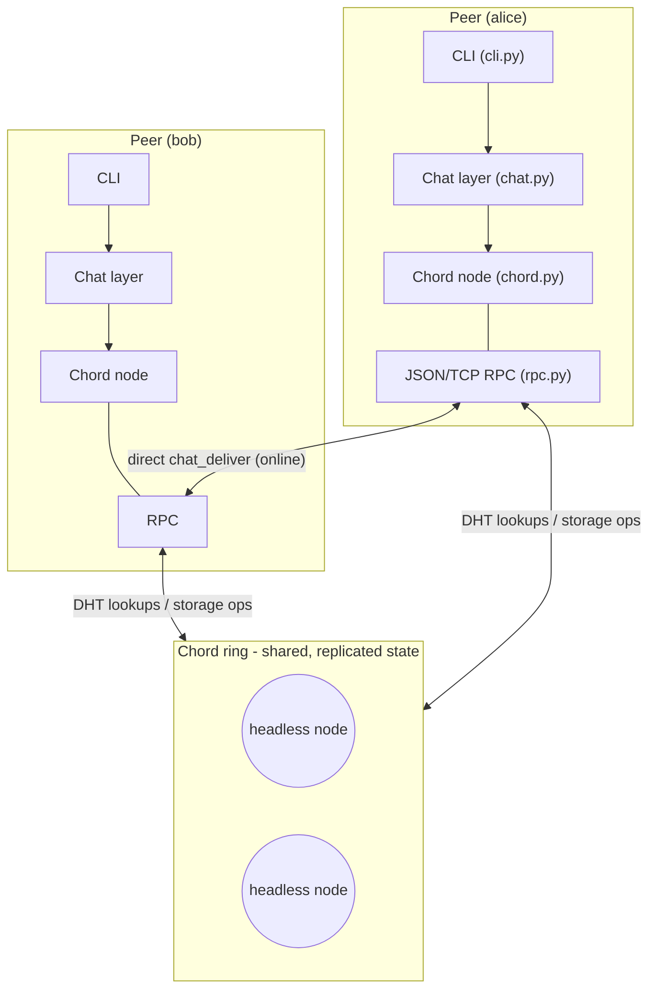
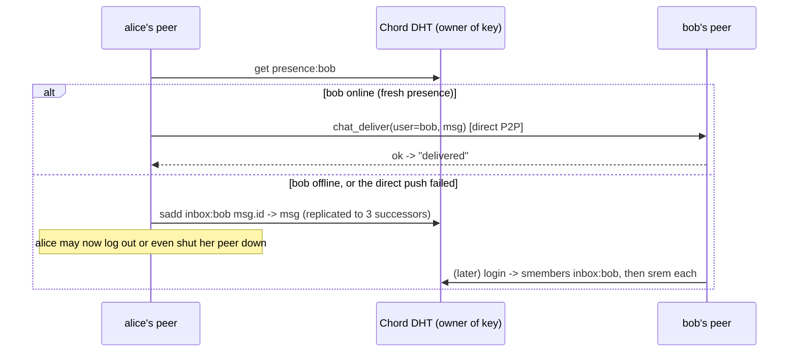

# conf-chat

**Conf-Chat** is a peer-to-peer chat system. It supports one-to-one messages, offline delivery and multi-user conference chats, and it has **no central server**. Every participant runs a peer. The peers together form a **Chord distributed hash table (DHT)**, and that DHT holds all shared state: accounts, friend lists, offline inboxes and conferences. Messages to users who are online go directly from one peer to the other.

Peers can join or leave at any time, including by crashing, without any reconfiguration. Every key in the DHT is replicated on several peers.

---

## Contents
1. [Features (the use case)](#1-features-the-use-case)
2. [Installation](#2-installation)
3. [Running Conf-Chat](#3-running-conf-chat)
4. [Command reference](#4-command-reference)
5. [Architecture](#5-architecture)
6. [The P2P layer: Chord](#6-the-p2p-layer-chord)
7. [The chat protocol on top of the DHT](#7-the-chat-protocol-on-top-of-the-dht)
8. [Demo walkthrough](#8-demo-walkthrough)
9. [Tests](#9-tests)
10. [Design decisions, assumptions and limitations](#10-design-decisions-assumptions-and-limitations)
11. [Project layout](#11-project-layout)

---

## 1. Features (the use case)

Conf-Chat implements the suggested use case in full:

| Requirement | How Conf-Chat does it |
|---|---|
| Register with username, password and **full name** | `register`. Usernames are unique across the whole network. The DHT does an atomic `put_if_absent` on the node that owns the key. |
| Log in with username + password | `login`. Passwords are stored as salted PBKDF2-SHA256 hashes, never in plain text. |
| **Change password** | `passwd` (you must give the current password). |
| See **which friends are logged in** | Shown at login. `friends` shows it at any time. Friends also get live *"bob is now online/offline"* notices. |
| **Search** for people by name (word match against full names) | `search <words…>` returns every user whose full name contains *all* of the given words. It uses a distributed inverted index (`word:<w>` keys). |
| **Friend requests** that must be **authorized** | `add <user>`, then the other user runs `accept <user>` (or `reject`). Only then are the two users friends. Pending requests survive while the recipient is offline. |
| Message a friend **online or offline** | `msg <user> <text>`. If the friend is online, the message goes straight to their peer. If not, it is stored in their DHT inbox and delivered at their next login, **even if the sender has gone offline or their peer has left the network**. |
| **Conference chats** | `conf new <name> [friends…]` creates a conference, and `c <id> <text>` sends to all participants. |
| Any participant can **add** others at any time | `conf add <id> <friend>`. |
| Nobody can join a conference unless a participant adds them | Only members can send to, read from or add to a conference. |
| Leaving the system means leaving all conferences | `logout` or `quit` removes you from every conference. You get no further messages from them, even after logging in again, unless someone invites you back. |
| **Pure P2P**, nodes added or removed freely | A Chord ring with joins, graceful leaves and crash recovery; keys are replicated on *r* = 3 successors. |

One small policy choice of our own: you can only add **your friends** to a conference. This keeps strangers from pulling you into chats, and it fits the friend-authorization model.

---

## 2. Installation

Conf-Chat is written in **Python and uses only the standard library**, so there is nothing to `pip install`.

**P2P framework.** Conf-Chat runs on its own implementation of the **Chord** protocol (Stoica et al., *"Chord: A Scalable Peer-to-peer Lookup Service for Internet Applications"*, SIGCOMM 2001), in [`confchat/chord.py`](confchat/chord.py). That is the same protocol [OpenChord](http://open-chord.sourceforge.net/) implements. The assignment allows "OpenChord or another P2P architecture", and I chose to implement Chord myself rather than install OpenChord for two reasons:
* OpenChord's last release was in 2008 (Java 5 era) and it is no longer maintained.
* The chat needs storage operations that run **atomically on the node that owns a key**. For example, many peers write to the same offline inbox. OpenChord's public API doesn't offer that. Having my own Chord also makes it possible to show ring internals (`ring`, `nodes`, `keys`) during the demo.

**Steps:**

```bash
# 1. Install Python 3.9 or newer (tested with 3.13 on Windows 11): https://www.python.org/downloads/
python --version

# 2. Get the code
git clone https://github.com/<your-account>/conf-chat.git
cd conf-chat

# 3. (optional) check that everything works - starts real local rings
python -m unittest discover -s tests -v
```

That's all: no build step, no database and no server to set up.

---

## 3. Running Conf-Chat

Every process is a full peer. The **first** peer creates the ring, and every other peer joins through **any** peer that is already running.

```bash
# first peer - creates a new ring
python -m confchat --port 5000

# more peers - join through any existing peer (here, the first one)
python -m confchat --port 5001 --join 127.0.0.1:5000
python -m confchat --port 5002 --join 127.0.0.1:5001
```

A peer can also run **headless**, which means it only stores data and routes lookups and has no chat UI. That makes it easy to show nodes being added and removed:

```bash
python -m confchat --port 5003 --join 127.0.0.1:5000 --headless --status 10
```

**Across several machines on a LAN**, give each peer its own reachable IP:

```bash
python -m confchat --host 192.168.1.20 --bind 0.0.0.0 --port 5000
python -m confchat --host 192.168.1.21 --bind 0.0.0.0 --port 5000 --join 192.168.1.20:5000
```

| Option | Meaning |
|---|---|
| `--port N` | TCP port to listen on (default: random free port) |
| `--join HOST:PORT` | any running peer; leave it out to start a new ring |
| `--host IP` | the address other peers use to reach this one (default `127.0.0.1`) |
| `--bind IP` | network interface to listen on (default: same as `--host`) |
| `--headless` | DHT node only, with no chat UI |
| `--status N` | headless only: print the ring state every N seconds |
| `--interval S` | Chord stabilization period in seconds (default 1.0) |
| `--no-color`, `-v` | turn off colours / log Chord activity |

**One-click demo on Windows:** `powershell -ExecutionPolicy Bypass -File scripts\demo.ps1` opens two headless DHT nodes and three chat windows. `scripts/demo.sh` does the same on Linux and macOS.

---

## 4. Command reference

```
Accounts      register [user] | login [user] | passwd | logout
Friends       friends | search <words...> | add <user> | requests | accept <user> | reject <user>
Messages      msg <user> <text>
Conferences   conf new <name> [users...] | conf add <id> <user> | conf leave <id> | confs | c <id> <text>
P2P internals ring | nodes | keys
              help | quit
```

* `ring` shows this node's Chord id, predecessor, successor list, finger table and key counts.
* `nodes` walks the successor pointers around the whole ring and lists every peer.
* `keys` lists the DHT keys stored on this node and whether this node is the owner or holds a replica.

---

## 5. Architecture



Every peer has three layers:

| Layer | File | Responsibility |
|---|---|---|
| Transport | `confchat/rpc.py` | Asynchronous JSON-lines RPC over TCP. Each peer is both client and server. Client connections are pooled and reused. |
| P2P overlay | `confchat/chord.py` | The Chord ring: routing, membership, replication and the storage operations. |
| Application | `confchat/chat.py` | Accounts, presence, friends, messages and conferences, built only from DHT operations plus direct peer-to-peer delivery. |
| UI | `confchat/cli.py` | Interactive terminal. Incoming messages print while you type. |

No component is special: the first peer is only the first contact point, and any peer can serve as the `--join` address.

---

## 6. The P2P layer: Chord

**Identifier ring.** Node ids are `SHA-1(host:port)` and key ids are `SHA-1(key)`, both on a 2^160 ring. A key is stored on its **successor**: the first node clockwise whose id is greater than or equal to the key's id.

**Routing (lookups).** Each node keeps a **finger table** in which entry *i* points to `successor(n + 2^i)`. Lookups are iterative. The asking node repeatedly asks the *closest preceding* node it knows about (`step` RPC) until it reaches the key's owner, which takes O(log N) hops.

**Membership maintenance.** Each node runs these periodic jobs every `--interval` seconds:
* `stabilize`: asks the successor for its predecessor, adopts it if it lies in between, then calls `notify` on the successor. It also refreshes the **successor list** (r = 3).
* `check_predecessor`: pings the predecessor and forgets it if it is dead.
* `fix_fingers`: rebuilds the finger table, reusing a lookup result for every consecutive finger it covers.
* `replicate`: pushes every key this node owns to its r successors.

**Joining.** A new node asks any existing node for `find_successor(own id)`, then stabilizes right away. When the successor accepts the newcomer as its predecessor, it **hands over** the keys the newcomer now owns.

**Leaving gracefully** (`quit` or Ctrl+C). The node sends its keys to its successor and tells its predecessor and successor to link to each other.

**Crashes.** A node that stops answering is marked dead and dropped from the successor list and finger table. Its successor already holds replicas of the dead node's keys, so it becomes their owner. The test suite checks that data survives a crash.

**Storage operations** run **atomically on the owning node**. Each node is a single asyncio event loop, so one operation finishes before the next starts. The operations are `get`, `put`, `put_if_absent`, `delete`, `sadd`, `srem` and `smembers`. Each write bumps a version number, and replicas keep the newest version they have seen. Because the owner applies set operations, two peers writing to the same inbox at the same time never lose messages. If a node is asked about a key it does not own (for example, while the ring is changing), it answers *redirect*, and the client looks the key up again.

---

## 7. The chat protocol on top of the DHT

### Data stored in the DHT

| Key | Value | Written by |
|---|---|---|
| `user:<username>` | `{username, full_name, salt, pw (PBKDF2 hash), created}` | register, change password |
| `word:<word>` | set of usernames whose full name contains `<word>` (inverted index for search) | register |
| `presence:<username>` | `{addr: "host:port" of the user's peer, ts}`, refreshed every 5 s | login, heartbeat, logout |
| `friends:<username>` | set of usernames | accept |
| `freq:<username>` | set of pending incoming friend requests | add, accept, reject |
| `inbox:<username>` | set of undelivered messages (`msg id → message`) | any sender |
| `conf:<id>` | `{id, name, creator, created}` | conf new |
| `confmembers:<id>` | set of current participants | conf new / add / leave, logout |
| `userconfs:<username>` | set of conference ids the user belongs to | same as above |

A user counts as **online** if their `presence` record is less than 15 s old. A crashed peer therefore goes offline on its own, without any cleanup.

### Message delivery



Every message carries a unique id, so it is never shown twice. While a user is online, their heartbeat also drains their inbox, which catches anything stored during a short network glitch.

### Friend requests
1. `add bob`: alice's peer does `sadd freq:bob alice` and, if bob is online, sends him a live notice.
2. `accept alice`: bob's peer does `sadd friends:bob alice` and `sadd friends:alice bob`, removes the request, and sends alice a "bob accepted" message, which goes to her inbox if she is offline.
3. If both users have requested each other, the second `add` accepts automatically.

### Conferences
* `conf new team bob carol` creates `conf:<id>`, adds every participant to `confmembers:<id>` and to each user's `userconfs`, and notifies those invited.
* `c <id> text` reads `confmembers:<id>`. The sender's peer then **fans the message out** to each participant using the same online/offline delivery as direct messages. No conference server exists. Any member's peer can send.
* `conf add <id> dave` works only for current members. Dave is added and all participants are notified.
* `logout` (and `quit`) runs `conf leave` for each of the user's conferences, so the user receives nothing further from them, even after logging back in, unless someone adds them again.

---

## 8. Demo walkthrough

A suggested 5-minute script for the class demo. It uses `scripts\demo.ps1`, which opens three chat windows and two DHT windows.

1. **The ring.** In a chat window, run `nodes` to show every peer on the ring, then `ring` to show the predecessor, successors and fingers.
2. **Accounts.** Window 1: `register alice` (full name *Alice Marie Smith*). Window 2: `register bob` (*Bob Smith*). Window 3: `register carol` (*Carol Jones*). Log each one in.
3. **Search and friends.** alice runs `search smith`, which finds bob, then `add bob`. bob sees the request live and runs `accept alice`. alice's `friends` now lists bob as **online**.
4. **Direct message (online).** `msg bob hello!` arrives right away; the sender sees *(delivered)*.
5. **Offline message.** bob runs `logout`. alice runs `msg bob see you later` and sees *(bob is offline - stored in the DHT)*. Then alice **quits**, so her peer leaves the ring. bob logs in again and the message appears under *"while you were away"*.
6. **Conference.** bob and carol become friends. alice (logged back in) runs `conf new team bob`, bob runs `conf add <id> carol`, and everyone talks with `c <id> ...`.
7. **Leaving means leaving.** carol runs `logout` and the others see *"carol logged out"*. Messages sent now never reach her, and after she logs in, `confs` is empty until someone runs `conf add` for her again.
8. **Fault tolerance.** Run `keys` on a peer to see the keys it owns. **Close a headless node's window** (a crash) and keep chatting: the replicas take over. Start a new node with `--join`, then run `nodes` to show it in the ring.
9. **Change password.** Run `passwd`, then log out and back in with the new password.

---

## 9. Tests

```bash
python -m unittest discover -s tests -v
```

The tests start real Chord rings of 4 to 6 nodes on localhost, in a single process:

* `tests/test_chord.py`: interval arithmetic; ring formation; every lookup reaches the correct owner from any node; `put`/`get` from any node; **30 concurrent writers** to one set without losing anything; `put_if_absent`; **data survives the crash of the key's owner**; graceful leave plus a new join keeps every key, and the newcomer receives the keys it now owns.
* `tests/test_chat.py`: registration with unique usernames; login and wrong passwords; search (all words must match); password change; friend request and accept; friends' online status; online delivery; **offline delivery after both the recipient logged out and the sender's peer left the ring**; conference creation, members adding members, non-members cannot participate, logout removes you from conferences, re-invitation; conference messages to offline members; only one session per user.

---

## 10. Design decisions, assumptions and limitations

* **"Leaves the system" means logging out or quitting** (an explicit action). A user whose peer *crashes* simply shows as offline when their presence expires. They stay in their conferences and get those messages at their next login.
* **One session per user.** You cannot log in while a fresh presence record for that user exists on another peer.
* **Security model.** There is no trusted server, so every record (including password hashes) is stored on other peers. Passwords are salted and hashed with PBKDF2 (100k iterations) and never sent or stored in plain text, but a malicious peer could still tamper with the data it stores. A production system would sign records with per-user key pairs. Messages are not encrypted (TLS is left as future work).
* **Persistence.** DHT data lives in the memory of the peers and is replicated on 3 successors. It survives individual nodes leaving or crashing, but not every node shutting down at once.
* **Consistency.** Each key has a single owner that applies operations in order, and replication is asynchronous, with version numbers deciding which copy wins. While the ring is repairing, a request can be redirected and retried, and the client does this automatically.
* **Clocks.** Online status compares wall-clock timestamps, so machines in a LAN demo should have roughly synchronized clocks (NTP is enough).

---

## 11. Project layout

```
conf-chat/
├── confchat/
│   ├── __main__.py     # python -m confchat
│   ├── cli.py          # interactive terminal UI and command-line options
│   ├── chat.py         # Conf-Chat protocol: accounts, friends, messages, conferences
│   ├── chord.py        # Chord DHT: ring, lookups, stabilization, replication, storage ops
│   └── rpc.py          # JSON-over-TCP RPC with connection pooling
├── scripts/
│   ├── demo.ps1        # Windows: opens 2 DHT nodes + 3 chat windows
│   └── demo.sh         # Linux/macOS equivalent
├── tests/
│   ├── test_chord.py   # DHT tests (lookups, concurrency, crash, leave/join)
│   └── test_chat.py    # end-to-end use-case tests
├── LICENSE
└── README.md
```
